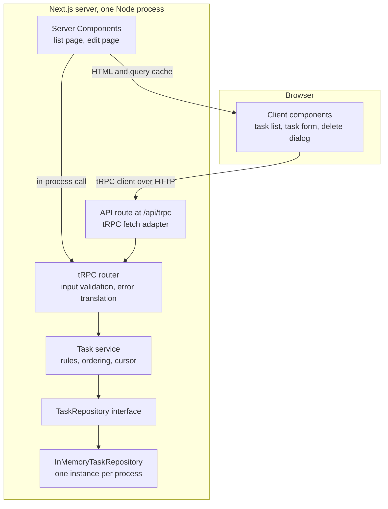

# Task manager

A small task manager built for a written case. You can add a task with a title and an optional description, see your tasks newest first, edit one and delete one. The list loads more tasks as you scroll. It runs on Next.js 15, and the browser talks to the server through tRPC 11. The tasks live in the server's memory, as the brief asks, so there is no database to set up, and a restart empties the list. It has a light and a dark theme.

## Running

You need Node 22 (the exact version is in `.nvmrc`) and pnpm. `corepack enable` installs the pnpm version pinned in `package.json`.

```sh
pnpm install
pnpm dev
```

The application runs at http://localhost:3000 and starts with 50 fictitious sample tasks, so the infinite scroll has something to load right away.

`SAMPLE_TASK_COUNT` sets how many sample tasks the store starts with, and `0` turns them off. Copy `.env.example` to `.env.local` and change the value there, or set it for one run:

```sh
SAMPLE_TASK_COUNT=0 pnpm dev
```

| Command             | What it does                                             |
| ------------------- | -------------------------------------------------------- |
| `pnpm typecheck`    | Type checks the project, no build needed                 |
| `pnpm lint`         | Runs ESLint                                              |
| `pnpm format:check` | Checks formatting with Prettier (`pnpm format` fixes it) |
| `pnpm test`         | Runs the service, router and component tests once        |
| `pnpm build`        | Builds the production application                        |
| `pnpm start`        | Serves the production build that `pnpm build` makes      |
| `pnpm test:e2e`     | Runs the browser tests against the production build      |

The browser tests need a build and Chromium:

```sh
pnpm exec playwright install chromium
pnpm build
pnpm test:e2e
```

They start the production build on port 3100, or on the port in `E2E_PORT`, and stop it when they finish. They refuse to run if something already listens on that port. They expect the default 50 sample tasks, so leave `SAMPLE_TASK_COUNT` unset when you run them.

Continuous integration runs every command above on each pull request ([`.github/workflows/ci.yml`](.github/workflows/ci.yml)).

## The short answers

These are the questions I asked myself while building this, each with the answer I landed on. The longer reasoning is in the [decision records](docs/adr).

**Where is the list built, on the server or in the browser?**

On the server, on every request. I asked four questions about the page.

1. Does the HTML change between requests? Yes. Anyone can add or delete a task at any moment, so a page built once and reused would be wrong.
2. Does the first thing you see need the tasks? Yes. The brief asks for a server-rendered list, so the first 20 tasks are already in the HTML.
3. How old can the data be? Not old at all. The server builds the page for each visit and tells the browser not to cache it.
4. What does a rush of visitors cost? The server builds the page again for every visit. With one process and a short list that is cheap, about 9 ms a page.

The record is [ADR 0004](docs/adr/0004-ssr-by-server-prefetch-and-hydration.md).

**Why can I read the page before the buttons work?**

The server sends finished HTML, so the tasks show at once. The buttons need the page's scripts, which arrive later. Wiring the scripts to the HTML is called hydration. On a simulated phone the tasks show at 0.8 s and the page answers a click at 2.5 s. During that gap the list ends in grey placeholder rows, and Save shows a spinner instead of looking ready.

**Why is it slow with `pnpm dev` on a throttled connection?**

The development server sends about 20 times more script than the production build, 3.8 MB against 194 kB. Use `pnpm build` and `pnpm start` to judge speed.

**Why tRPC instead of a REST API?**

One team owns both sides, and both are TypeScript. With tRPC the browser calls server functions by name and the compiler checks every call. Rename a field on the server and the browser code stops compiling. I would not pick it for an API that outsiders or other languages call.

**Where is the rule for a valid task?**

In one file, [`src/server/tasks/task.ts`](src/server/tasks/task.ts). The form and the server both use that schema, so they can't disagree. The form checks each field as you type. The server checks again, because anyone can call the API without the form.

**Why does the list continue from a cursor instead of page numbers?**

With page numbers, a task added while you scroll pushes every row down one place, and page 2 repeats a row you already saw. A cursor asks for the tasks after the last one you have, so nothing repeats and nothing is skipped. The record is [ADR 0006](docs/adr/0006-cursor-pagination-for-the-task-list.md).

**What happens when the connection drops?**

A save, a delete or a list load fails at once and says so. Nothing waits in silence for the network. A delete that fails puts its row back. When the connection returns, press Retry.

**What happens to my tasks when the server restarts?**

They are gone. They live in the memory of one process. That is also why there is no hosted demo. On a serverless platform each copy of the server would hold its own list. The record is [ADR 0005](docs/adr/0005-tasks-live-in-one-node-process.md).

**How hard is it to add a database?**

One new class. Storage sits behind the `TaskRepository` interface, so the rules, the API and the list tests stay as they are. The record is [ADR 0003](docs/adr/0003-task-service-over-a-repository.md).

**Why English field names when the brief says `titulo`?**

The hiring process asks for every deliverable in English, and one language across the code reads better than `task.titulo`. The mapping is in a table below. The record is [ADR 0002](docs/adr/0002-english-field-names.md).

**Why Next.js 15 and not 16?**

The brief names version 15. It is the only version the brief pins, so it wins over "the most recent versions". The record is [ADR 0001](docs/adr/0001-next-15-instead-of-16.md).

## Architecture

The server has three layers, and the pages sit on top of them.

- The task module in [`src/server/tasks`](src/server/tasks) holds the task type, the input schemas, the rules and the domain errors. It imports nothing from tRPC, Next.js or React. The task service implements the five operations on top of a `TaskRepository` interface, and `InMemoryTaskRepository` is the one implementation.
- The tRPC router in [`src/server/trpc`](src/server/trpc) is a thin transport. Each procedure validates its input with the task module's schema and calls the service. One middleware turns domain errors into tRPC errors.
- The list page and the edit page are Server Components. They call the router as a plain function in the same process, with no HTTP request, and send what they loaded to the browser inside the HTML. The client components start from that data, so the first paint has no loading state. Every later call, writes included, goes through the tRPC client to `/api/trpc`.
- The form validates with the same schema as the server, so the two sides can't disagree about what a valid task is.
- The interface is built from shadcn/ui components, and every colour is a theme variable in [`src/app/globals.css`](src/app/globals.css). Its layout follows one reference, the to-do app Things 3: no header bar, one bold title per page, and rows without boxes.



## Requirements

Every requirement and bonus of the brief, and where it is met.

| Brief                                 | Where it is met                                                                                                                                                                                                                                                                                                                                                                                               |
| ------------------------------------- | ------------------------------------------------------------------------------------------------------------------------------------------------------------------------------------------------------------------------------------------------------------------------------------------------------------------------------------------------------------------------------------------------------------- |
| Project setup: Next.js 15, tRPC       | [`package.json`](package.json), [`src/server/trpc/init.ts`](src/server/trpc/init.ts), [`src/app/api/trpc/[trpc]/route.ts`](src/app/api/trpc/[trpc]/route.ts), [ADR 0001](docs/adr/0001-next-15-instead-of-16.md)                                                                                                                                                                                              |
| Task model                            | [`src/server/tasks/task.ts`](src/server/tasks/task.ts), field names mapped below                                                                                                                                                                                                                                                                                                                              |
| Tasks kept in memory                  | [`src/server/tasks/in-memory-task-repository.ts`](src/server/tasks/in-memory-task-repository.ts), [`src/server/tasks/task-store.ts`](src/server/tasks/task-store.ts), [ADR 0005](docs/adr/0005-tasks-live-in-one-node-process.md)                                                                                                                                                                             |
| Create a task                         | `task.create` in [`src/server/trpc/task-router.ts`](src/server/trpc/task-router.ts), tested in [`create-task.test.ts`](src/server/tasks/create-task.test.ts) and [`task-router.create.test.ts`](src/server/trpc/task-router.create.test.ts)                                                                                                                                                                   |
| List the tasks                        | `task.list`, tested in [`list-tasks.test.ts`](src/server/tasks/list-tasks.test.ts) and [`task-router.list.test.ts`](src/server/trpc/task-router.list.test.ts)                                                                                                                                                                                                                                                 |
| Update a task                         | `task.update`, and `task.getById` to fill the edit page, tested in [`update-task.test.ts`](src/server/tasks/update-task.test.ts) and [`task-router.update.test.ts`](src/server/trpc/task-router.update.test.ts)                                                                                                                                                                                               |
| Delete a task                         | `task.delete`, tested in [`delete-task.test.ts`](src/server/tasks/delete-task.test.ts) and [`task-router.delete.test.ts`](src/server/trpc/task-router.delete.test.ts)                                                                                                                                                                                                                                         |
| Validation and meaningful errors      | Rules in [`src/server/tasks/task.ts`](src/server/tasks/task.ts), domain errors in [`errors.ts`](src/server/tasks/errors.ts), translation and formatting in [`init.ts`](src/server/trpc/init.ts), messages for people in [`describe-error.ts`](src/features/tasks/describe-error.ts)                                                                                                                           |
| Server-rendered task list             | [`src/app/page.tsx`](src/app/page.tsx), [`src/components/task-list.tsx`](src/components/task-list.tsx), [ADR 0004](docs/adr/0004-ssr-by-server-prefetch-and-hydration.md), tested in [`e2e/task-list.spec.ts`](e2e/task-list.spec.ts)                                                                                                                                                                         |
| Delete with feedback on the list      | [`delete-task-button.tsx`](src/features/tasks/delete-task-button.tsx), [`use-delete-task.ts`](src/features/tasks/use-delete-task.ts), tested in [`e2e/delete-task.spec.ts`](e2e/delete-task.spec.ts)                                                                                                                                                                                                          |
| Create and edit form with hooks       | [`task-form.tsx`](src/features/tasks/task-form.tsx) on react-hook-form with the server's Zod schema, checking each field as it is typed, used by [`create-task-form.tsx`](src/features/tasks/create-task-form.tsx) and [`edit-task-form.tsx`](src/features/tasks/edit-task-form.tsx), tested in [`task-form.test.tsx`](src/features/tasks/task-form.test.tsx)                                                 |
| Loading, success and failure states   | Skeleton rows, retry alert and end-of-list note in [`task-list.tsx`](src/components/task-list.tsx), spinner and form alert in [`task-form.tsx`](src/features/tasks/task-form.tsx), skeleton rows and a Save that waits with a spinner before hydration, toasts after each write, error screen in [`src/app/error.tsx`](src/app/error.tsx), not found page in [`src/app/not-found.tsx`](src/app/not-found.tsx) |
| Bonus: infinite scroll                | [`task-list.tsx`](src/components/task-list.tsx), cursor in [`cursor.ts`](src/server/tasks/cursor.ts), [ADR 0006](docs/adr/0006-cursor-pagination-for-the-task-list.md), tested in [`e2e/infinite-scroll.spec.ts`](e2e/infinite-scroll.spec.ts)                                                                                                                                                                |
| Bonus: documentation of the decisions | This README, [`GLOSSARY.md`](GLOSSARY.md), the records under [`docs/adr`](docs/adr)                                                                                                                                                                                                                                                                                                                           |

The brief names the task's fields in Portuguese. The code uses English names everywhere, in the domain, the tRPC contract and the interface ([ADR 0002](docs/adr/0002-english-field-names.md)):

| Brief         | Code          |
| ------------- | ------------- |
| `id`          | `id`          |
| `titulo`      | `title`       |
| `descricao`   | `description` |
| `dataCriacao` | `createdAt`   |

## Decisions

- [0001, Next.js 15 instead of 16](docs/adr/0001-next-15-instead-of-16.md): the brief pins version 15, so the project uses the newest 15.5 and the newest stable release of everything else.
- [0002, English field names](docs/adr/0002-english-field-names.md): `title`, `description` and `createdAt` instead of the brief's Portuguese names, with the mapping above.
- [0003, A task service over a repository interface](docs/adr/0003-task-service-over-a-repository.md): the rules live in a module with no framework in it, and storage sits behind an interface that a database could implement.
- [0004, Server prefetch and hydration](docs/adr/0004-ssr-by-server-prefetch-and-hydration.md): the list page renders on every request, prefetches the first page into the query cache and hands it to the client's infinite query.
- [0005, Tasks live in one Node process](docs/adr/0005-tasks-live-in-one-node-process.md): the application runs with `next dev` or `next start` on one machine, and tasks are lost on restart.
- [0006, Cursor pagination](docs/adr/0006-cursor-pagination-for-the-task-list.md): pages continue from the creation date and id of the last task shown, so deleting or creating a task while scrolling never skips or repeats one.

## Testing

`pnpm test` runs the first three seams with Vitest, and `pnpm test:e2e` runs the fourth with Playwright. Each behaviour is tested at the one seam that can show it, and every service, router and form test starts from its own empty repository with the sample tasks off.

- **The task service over a fresh in-memory repository** ([`src/server/tasks/*.test.ts`](src/server/tasks)). The rules: trimming, the length limits, an empty description stored as absent, the server owning `id` and `createdAt`, newest-first order with the id breaking ties, and "not found" on get, update and delete. Pagination in depth, including a task deleted or created between two pages. The list tests are written against the repository interface, so a database implementation can run the same suite.
- **The tRPC router with no HTTP server** ([`src/server/trpc/*.test.ts`](src/server/trpc)). The contract: each procedure's happy path, `BAD_REQUEST` for invalid input and a malformed cursor, `NOT_FOUND` for an unknown id. Some tests send a `Request` through the fetch adapter, because only the wire shows that dates survive serialization, that validation messages arrive grouped by field and that an unexpected error carries no internal detail.
- **The form in a test DOM** ([`task-form.test.tsx`](src/features/tasks/task-form.test.tsx), with [`describe-error.test.ts`](src/features/tasks/describe-error.test.ts)). An empty title shows its message and sends nothing, a title past 120 characters shows its message as it is typed, a valid submit saves once with trimmed values, a pending save disables the button, server field errors land on their fields, and edit mode starts with the task's values.
- **The running application in a browser** ([`e2e`](e2e)). The first response holds the tasks in its markup and is not a static page, scrolling loads more tasks, create and edit return to the list with a confirmation, delete removes the row at once and a failed delete brings it back, and an unknown edit address answers 404. Before its scripts load, the list already ends in placeholder rows and Save can't be pressed. Saving a task doesn't make the rows jump. A long one-word title wraps in its row and in the delete dialog. An offline load shows the alert, and Retry loads the page. The theme toggle answers a second click during its fade. Every spec fails on a console error or page error it did not cause on purpose.

## Performance

I measured the production build on an Apple M1 laptop on 19 November 2026, with Node 22.18, Chromium 159 and Lighthouse 13.6.0, which asks for Node 22.19 or later and printed that warning on every run. The server, the browser and curl ran on the same machine, so no number here includes a real network. The list page held the default 50 sample tasks unless a table says otherwise.

### Page metrics

Lighthouse ran five times for each page and configuration. Each row gives the median and the lowest and highest of the five runs. Lighthouse computes both configurations by simulation from an unthrottled page load, so the numbers estimate a slower device rather than record one.

Desktop, Lighthouse's desktop preset:

| Metric                   | `/` median | `/` range     | `/tasks/new` median | `/tasks/new` range |
| ------------------------ | ---------- | ------------- | ------------------- | ------------------ |
| Performance score        | 100        | 100 to 100    | 100                 | 100 to 100         |
| First contentful paint   | 212 ms     | 211 to 223 ms | 211 ms              | 209 to 217 ms      |
| Largest contentful paint | 212 ms     | 211 to 223 ms | 211 ms              | 209 to 217 ms      |
| Total blocking time      | 0 ms       | 0 to 8 ms     | 0 ms                | 0 to 0 ms          |
| Cumulative layout shift  | 0          | 0 to 0        | 0                   | 0 to 0             |
| Speed index              | 212 ms     | 211 to 231 ms | 211 ms              | 209 to 217 ms      |
| Time to interactive      | 212 ms     | 211 to 589 ms | 211 ms              | 209 to 217 ms      |

Mobile, Lighthouse's default emulation, which simulates a slow 4G connection with a 150 ms round trip and about 1.6 Mbit/s down, and slows the CPU four times:

| Metric                   | `/` median | `/` range         | `/tasks/new` median | `/tasks/new` range |
| ------------------------ | ---------- | ----------------- | ------------------- | ------------------ |
| Performance score        | 100        | 97 to 100         | 100                 | 99 to 100          |
| First contentful paint   | 759 ms     | 759 to 763 ms     | 767 ms              | 761 to 769 ms      |
| Largest contentful paint | 759 ms     | 759 to 763 ms     | 767 ms              | 761 to 769 ms      |
| Total blocking time      | 81 ms      | 42 to 194 ms      | 81 ms               | 79 to 118 ms       |
| Cumulative layout shift  | 0          | 0 to 0            | 0                   | 0 to 0             |
| Speed index              | 759 ms     | 759 to 763 ms     | 767 ms              | 761 to 769 ms      |
| Time to interactive      | 2,527 ms   | 2,449 to 2,653 ms | 2,699 ms            | 2,690 to 2,735 ms  |

### Script size

The build column is the "First Load JS" table that `pnpm build` prints. The other two columns add up the gzip-compressed bytes of every script the page's HTML loads, measured with curl, with the uncompressed size after it. The build's figure is its own estimate and counts fewer chunks than the HTML loads.

| Route        | First Load JS in the build | Sent by `pnpm start`        | Sent by `pnpm dev`            |
| ------------ | -------------------------- | --------------------------- | ----------------------------- |
| `/`          | 186 kB                     | 194 kB, 623 kB uncompressed | 3.82 MB, 16.1 MB uncompressed |
| `/tasks/new` | 198 kB                     | 237 kB, 764 kB uncompressed | 4.81 MB, 20.2 MB uncompressed |

After the list page loads, the browser also prefetches about 45 kB of scripts for the new task page, because the page links to it.

### Server

Each cell gives two runs, each on a freshly started server, as the median and then the 95th percentile of 100 sequential requests in milliseconds, after 20 warm-up requests. The last page is the one `nextCursor` reaches at the end of the list. To find it, the walk goes in pages of 100, the largest the API allows, and then in pages of 20. `SAMPLE_TASK_COUNT` has no upper limit. A page holds 20 tasks by default, so the HTML of `/` was 110 kB uncompressed at every count.

| Request                 | 50 tasks               | 1,000 tasks            | 10,000 tasks           | 100,000 tasks            |
| ----------------------- | ---------------------- | ---------------------- | ---------------------- | ------------------------ |
| List page `/`           | 8.5 / 10.9, 8.9 / 11.4 | 8.7 / 11.0, 8.7 / 12.1 | 9.3 / 10.6, 9.2 / 11.1 | 13.1 / 15.5, 12.5 / 14.5 |
| `task.list`, first page | 1.7 / 1.9, 1.8 / 2.2   | 2.2 / 4.0, 1.8 / 2.2   | 2.0 / 4.1, 2.1 / 2.4   | 5.9 / 7.4, 5.9 / 7.7     |
| `task.list`, last page  | 1.6 / 2.0, 1.7 / 1.9   | 1.9 / 2.1, 1.8 / 2.2   | 2.0 / 3.3, 2.0 / 2.3   | 4.7 / 5.5, 4.3 / 4.9     |

### What the numbers say

**The pages show fast.** Both draw in about 0.2 s on desktop and 0.8 s on the emulated phone, and nothing moves after it draws.

**The wait is for the scripts.** On the emulated phone the list page is readable at 0.8 s and answers a click at about 2.5 s. For close to 2 s you can read the tasks and the buttons don't work yet. Lighthouse counts about 0.9 s of script work on the main thread in that time. A long task is a stretch of work that blocks a click, and the parts of the long tasks beyond 50 ms add up to 42 to 194 ms.

**The server stays quick until the list gets very long.** Two runs put every median within 0.7 ms of each other, and the 95th percentile moved by up to 1.8 ms. Up to 10,000 tasks a list request takes about 2 ms. At 100,000 it takes about 6 ms. The cause is in `InMemoryTaskRepository.listPage`. On every request it copies all the tasks and filters them, then sorts the ones after the cursor. The first page sorts the whole list and takes 5.9 ms. The last page sorts about one page of tasks and takes 4.3 to 4.7 ms. That difference is the sort. A database with an index on the creation date and the id would read one page of rows and skip the rest.

**Don't judge speed with `pnpm dev`.** The Running section starts the development server, and it sends 3.82 MB of compressed scripts for the list page, about 20 times what the production build sends. Development bundles are not minified, carry React's development build and embed source maps, which are more than half the uncompressed bytes of the three largest chunks. Chrome DevTools' 3G preset downloads at about 400 kbit/s, so those scripts take about 76 s, against about 4 s for the production build. The HTML arrives long before the scripts do, so on a slow connection you can read the tasks well before the page answers a click. Use `pnpm build` and `pnpm start` to judge speed.

### Reproducing

Build, then start the production server on a free port with the number of sample tasks to measure:

```sh
pnpm build
SAMPLE_TASK_COUNT=50 pnpm start -p 3200
```

Lighthouse, five runs. Add `--preset=desktop` for the desktop configuration, and use `/tasks/new` for the form page. Lighthouse uses the installed Chrome, or the one `CHROME_PATH` names.

```sh
for i in 1 2 3 4 5; do
  pnpm dlx lighthouse@13.6.0 http://localhost:3200/ --only-categories=performance \
    --output=json --output-path=list-mobile-$i.json --chrome-flags="--headless=new --mute-audio"
done
```

Each report holds the score at `.categories.performance.score` and each metric at `.audits["<id>"].numericValue`, with the ids `first-contentful-paint`, `largest-contentful-paint`, `total-blocking-time`, `cumulative-layout-shift`, `speed-index`, `interactive` and `mainthread-work-breakdown`. This prints one metric's median and range over the five reports:

```sh
jq -s 'map(.audits["total-blocking-time"].numericValue) | sort | {min: .[0], median: .[2], max: .[4]}' list-mobile-*.json
```

Script size, the compressed and the uncompressed bytes of every script the HTML loads. Set `page=/tasks/new` for the form page, and point `url` at port 3000 to measure `pnpm dev`.

```sh
url=http://localhost:3200
page=/
curl -s "$url$page" | grep -oE '<script[^>]+src="[^"]+"[^>]*>' | grep -v noModule |
  grep -oE '/_next/[^"]+' | sed 's/&amp;/\&/g' | sort -u |
  while read -r src; do
    gz=$(curl -s -o /dev/null -H 'Accept-Encoding: gzip, deflate, br, zstd' -w '%{size_download}' "$url$src")
    raw=$(curl -s -o /dev/null -H 'Accept-Encoding: identity' -w '%{size_download}' "$url$src")
    echo "$gz $raw"
  done | awk '{ gz += $1; raw += $2 } END { print gz " compressed, " raw " uncompressed" }'
```

Server timings, with the server restarted at each `SAMPLE_TASK_COUNT`, twice. The loop that finds the last page needs `jq`.

```sh
url=http://localhost:3200
time_requests() {
  for i in $(seq 20); do curl -s -o /dev/null "$1"; done
  for i in $(seq 100); do curl -s -o /dev/null -w '%{time_total}\n' "$1"; done | sort -n |
    awk '{ t[NR] = $1 * 1000 } END { printf "median %.1f ms, p95 %.1f ms\n", (t[50] + t[51]) / 2, t[95] }'
}
time_requests "$url/"
time_requests "$url/api/trpc/task.list?input=%7B%22json%22%3A%7B%7D%7D"

api="$url/api/trpc/task.list"
cursor=""
for limit in 100 20; do
  while :; do
    input="{\"json\":{\"limit\":$limit${cursor:+,\"cursor\":\"$cursor\"}}}"
    next=$(curl -s -G "$api" --data-urlencode "input=$input" | jq -r '.result.data.json.nextCursor')
    [ "$next" = null ] && break
    cursor=$next
  done
done
time_requests "$api?input=$(jq -rn --arg c "$cursor" '{json: {cursor: $c}} | tojson | @uri')"
```

## Limits and next steps

Tasks live in the memory of one Node process ([ADR 0005](docs/adr/0005-tasks-live-in-one-node-process.md)). Every task is lost when the server restarts, and the application can't run on more than one process: on a serverless platform each instance would hold its own list. That is why there is no hosted demo.

For production I would change these things, roughly in this order:

- Put a database behind the `TaskRepository` interface. That is one new class, and the service, the router and the list tests stay as they are.
- Add authentication, so each person sees only their own tasks.
- Add rate limiting on the API route.
- Do the rest of the hardening a public API needs: CORS rules, limits on request size, and logging and monitoring that go somewhere other than the console.

Two smaller things I know about:

- When the connection comes back, nothing reloads by itself. The alert stays until you press Retry.
- Rarely, the list page logs a hydration error, React error 418, on its first load. I saw it a handful of times in several hundred local runs, mostly with the machine under heavy load, and never in continuous integration. I have not found the cause.

## How this was built

I started with a design interview against the brief. It produced the [glossary](GLOSSARY.md) and the [decision records](docs/adr). From those I wrote the spec, which is [issue #1](../../issues/1). I split the work into tickets, each a sub-issue of the spec with its own verify gate, the commands that must pass before the ticket lands. A coding agent built each ticket in its own git worktree, and [pull request #15](../../pull/15) brought them together.

Every pull request gets a review by models, and I check each finding by hand before anything merges.

Then I tested the application by hand, and that found things the tests and the reviews had not. On a throttled connection I could read the page long before it answered a click, which led to the fixes in [#18](../../pull/18). The first interface was plainer than I wanted, so [#19](../../pull/19) reworks every screen after one reference. [#20](../../pull/20) adds the performance numbers above. Before those merged, a visual sweep compared the old version and the new one screenshot by screenshot. It caught two regressions that every passing test had missed.
