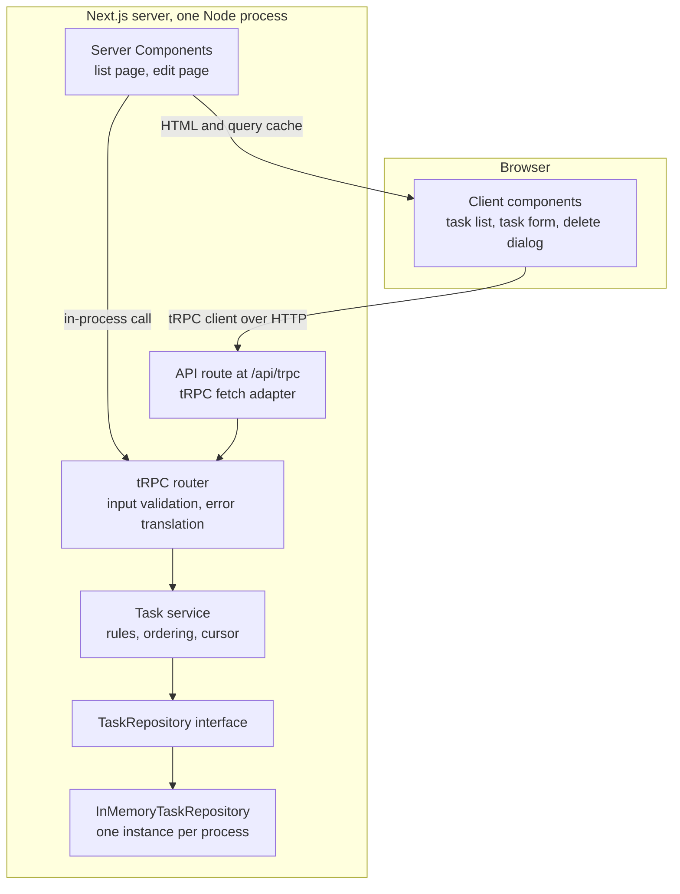

# Task manager

A small task manager built for a written case. You can create a task with a title and an optional description, see the tasks newest first in a list that loads more as you scroll, edit a task and delete it. The application runs on Next.js 15 and exposes every operation through tRPC 11. The tasks live in the memory of the server process, as the brief asks, so there is no database to set up.

## Running

You need Node 22 (the exact version is in `.nvmrc`) and pnpm. `corepack enable` installs the pnpm version pinned in `package.json`.

```sh
pnpm install
pnpm dev
```

The application runs at http://localhost:3000 and starts with 50 fictitious sample tasks, so the infinite scroll has something to load right away.

`SAMPLE_TASK_COUNT` sets how many sample tasks the store starts with, and `0` turns them off. Copy `.env.example` to `.env.local` and change the value there, or set it for one run:

```sh
SAMPLE_TASK_COUNT=0 pnpm dev
```

| Command             | What it does                                             |
| ------------------- | -------------------------------------------------------- |
| `pnpm typecheck`    | Type checks the project, no build needed                 |
| `pnpm lint`         | Runs ESLint                                              |
| `pnpm format:check` | Checks formatting with Prettier (`pnpm format` fixes it) |
| `pnpm test`         | Runs the service, router and component tests once        |
| `pnpm build`        | Builds the production application                        |
| `pnpm start`        | Serves the production build that `pnpm build` makes      |
| `pnpm test:e2e`     | Runs the browser tests against the production build      |

The browser tests need a build and Chromium:

```sh
pnpm exec playwright install chromium
pnpm build
pnpm test:e2e
```

They start the production build on port 3100, or on the port in `E2E_PORT`, and stop it when they finish. They refuse to run if something already listens on that port. They expect the default 50 sample tasks, so leave `SAMPLE_TASK_COUNT` unset when you run them.

Continuous integration runs every command above on each pull request ([`.github/workflows/ci.yml`](.github/workflows/ci.yml)).

## Architecture

The server has three layers, and the pages sit on top of them.

- The task module in [`src/server/tasks`](src/server/tasks) holds the task type, the input schemas, the rules and the domain errors. It imports nothing from tRPC, Next.js or React. The task service implements the five operations on top of a `TaskRepository` interface, and `InMemoryTaskRepository` is the one implementation.
- The tRPC router in [`src/server/trpc`](src/server/trpc) is a thin transport. Each procedure validates its input with the task module's schema and calls the service. One middleware turns domain errors into tRPC errors.
- The list page and the edit page are Server Components. They call the router in-process, with no HTTP round trip, and send the query cache to the browser with the HTML. The client components read that cache and send every later call, writes included, through the tRPC client to `/api/trpc`.
- The form validates with the same schema as the server, so the two sides can't disagree about what a valid task is.



## Requirements

Every requirement and bonus of the brief, and where it is met.

| Brief                                 | Where it is met                                                                                                                                                                                                                                                                                                                                                                              |
| ------------------------------------- | -------------------------------------------------------------------------------------------------------------------------------------------------------------------------------------------------------------------------------------------------------------------------------------------------------------------------------------------------------------------------------------------- |
| Project setup: Next.js 15, tRPC       | [`package.json`](package.json), [`src/server/trpc/init.ts`](src/server/trpc/init.ts), [`src/app/api/trpc/[trpc]/route.ts`](src/app/api/trpc/[trpc]/route.ts), [ADR 0001](docs/adr/0001-next-15-instead-of-16.md)                                                                                                                                                                             |
| Task model                            | [`src/server/tasks/task.ts`](src/server/tasks/task.ts), field names mapped below                                                                                                                                                                                                                                                                                                             |
| Tasks kept in memory                  | [`src/server/tasks/in-memory-task-repository.ts`](src/server/tasks/in-memory-task-repository.ts), [`src/server/tasks/task-store.ts`](src/server/tasks/task-store.ts), [ADR 0005](docs/adr/0005-tasks-live-in-one-node-process.md)                                                                                                                                                            |
| Create a task                         | `task.create` in [`src/server/trpc/task-router.ts`](src/server/trpc/task-router.ts), tested in [`create-task.test.ts`](src/server/tasks/create-task.test.ts) and [`task-router.create.test.ts`](src/server/trpc/task-router.create.test.ts)                                                                                                                                                  |
| List the tasks                        | `task.list`, tested in [`list-tasks.test.ts`](src/server/tasks/list-tasks.test.ts) and [`task-router.list.test.ts`](src/server/trpc/task-router.list.test.ts)                                                                                                                                                                                                                                |
| Update a task                         | `task.update`, and `task.getById` to fill the edit page, tested in [`update-task.test.ts`](src/server/tasks/update-task.test.ts) and [`task-router.update.test.ts`](src/server/trpc/task-router.update.test.ts)                                                                                                                                                                              |
| Delete a task                         | `task.delete`, tested in [`delete-task.test.ts`](src/server/tasks/delete-task.test.ts) and [`task-router.delete.test.ts`](src/server/trpc/task-router.delete.test.ts)                                                                                                                                                                                                                        |
| Validation and meaningful errors      | Rules in [`src/server/tasks/task.ts`](src/server/tasks/task.ts), domain errors in [`errors.ts`](src/server/tasks/errors.ts), translation and formatting in [`init.ts`](src/server/trpc/init.ts), messages for people in [`describe-error.ts`](src/features/tasks/describe-error.ts)                                                                                                          |
| Server-rendered task list             | [`src/app/page.tsx`](src/app/page.tsx), [`src/components/task-list.tsx`](src/components/task-list.tsx), [ADR 0004](docs/adr/0004-ssr-by-server-prefetch-and-hydration.md), tested in [`e2e/task-list.spec.ts`](e2e/task-list.spec.ts)                                                                                                                                                        |
| Delete with feedback on the list      | [`delete-task-button.tsx`](src/features/tasks/delete-task-button.tsx), [`use-delete-task.ts`](src/features/tasks/use-delete-task.ts), tested in [`e2e/delete-task.spec.ts`](e2e/delete-task.spec.ts)                                                                                                                                                                                         |
| Create and edit form with hooks       | [`task-form.tsx`](src/features/tasks/task-form.tsx) on react-hook-form with the server's Zod schema, used by [`create-task-form.tsx`](src/features/tasks/create-task-form.tsx) and [`edit-task-form.tsx`](src/features/tasks/edit-task-form.tsx), tested in [`task-form.test.tsx`](src/features/tasks/task-form.test.tsx)                                                                    |
| Loading, success and failure states   | Skeleton rows, retry alert and end-of-list note in [`task-list.tsx`](src/components/task-list.tsx), spinner and form alert in [`task-form.tsx`](src/features/tasks/task-form.tsx), skeleton rows and a disabled Save before hydration, toasts after each write, error screen in [`src/app/error.tsx`](src/app/error.tsx), not found page in [`src/app/not-found.tsx`](src/app/not-found.tsx) |
| Bonus: infinite scroll                | [`task-list.tsx`](src/components/task-list.tsx), cursor in [`cursor.ts`](src/server/tasks/cursor.ts), [ADR 0006](docs/adr/0006-cursor-pagination-for-the-task-list.md), tested in [`e2e/infinite-scroll.spec.ts`](e2e/infinite-scroll.spec.ts)                                                                                                                                               |
| Bonus: documentation of the decisions | This README, [`GLOSSARY.md`](GLOSSARY.md), the records under [`docs/adr`](docs/adr)                                                                                                                                                                                                                                                                                                          |

The brief names the task's fields in Portuguese. The code uses English names everywhere, in the domain, the tRPC contract and the interface ([ADR 0002](docs/adr/0002-english-field-names.md)):

| Brief         | Code          |
| ------------- | ------------- |
| `id`          | `id`          |
| `titulo`      | `title`       |
| `descricao`   | `description` |
| `dataCriacao` | `createdAt`   |

## Decisions

- [0001, Next.js 15 instead of 16](docs/adr/0001-next-15-instead-of-16.md): the brief pins version 15, so the project uses the newest 15.5 and the newest stable release of everything else.
- [0002, English field names](docs/adr/0002-english-field-names.md): `title`, `description` and `createdAt` instead of the brief's Portuguese names, with the mapping above.
- [0003, A task service over a repository interface](docs/adr/0003-task-service-over-a-repository.md): the rules live in a module with no framework in it, and storage sits behind an interface that a database could implement.
- [0004, Server prefetch and hydration](docs/adr/0004-ssr-by-server-prefetch-and-hydration.md): the list page renders on every request, prefetches the first page into the query cache and hands it to the client's infinite query.
- [0005, Tasks live in one Node process](docs/adr/0005-tasks-live-in-one-node-process.md): the application runs with `next dev` or `next start` on one machine, and tasks are lost on restart.
- [0006, Cursor pagination](docs/adr/0006-cursor-pagination-for-the-task-list.md): pages continue from the creation date and id of the last task shown, so deleting or creating a task while scrolling never skips or repeats one.

## Testing

`pnpm test` runs the first three seams with Vitest, and `pnpm test:e2e` runs the fourth with Playwright. Each behaviour is tested at the one seam that can show it, and every service, router and form test starts from its own empty repository with the sample tasks off.

- **The task service over a fresh in-memory repository** ([`src/server/tasks/*.test.ts`](src/server/tasks)). The rules: trimming, the length limits, an empty description stored as absent, the server owning `id` and `createdAt`, newest-first order with the id breaking ties, and "not found" on get, update and delete. Pagination in depth, including a task deleted or created between two pages. The list tests are written against the repository interface, so a database implementation can run the same suite.
- **The tRPC router with no HTTP server** ([`src/server/trpc/*.test.ts`](src/server/trpc)). The contract: each procedure's happy path, `BAD_REQUEST` for invalid input and a malformed cursor, `NOT_FOUND` for an unknown id. Some tests send a `Request` through the fetch adapter, because only the wire shows that dates survive serialization, that validation messages arrive grouped by field and that an unexpected error carries no internal detail.
- **The form in a test DOM** ([`task-form.test.tsx`](src/features/tasks/task-form.test.tsx), with [`describe-error.test.ts`](src/features/tasks/describe-error.test.ts)). An empty title shows its message and sends nothing, a valid submit saves once with trimmed values, a pending save disables the button, server field errors land on their fields, and edit mode starts with the task's values.
- **The running application in a browser** ([`e2e`](e2e)). The first response holds the tasks in its markup and is not a static page, scrolling loads more tasks, create and edit return to the list with a confirmation, delete removes the row at once and a failed delete brings it back, and an unknown edit address answers 404. Every spec fails on a console error or page error it did not cause on purpose.

## Limits and next steps

Tasks live in the memory of one Node process ([ADR 0005](docs/adr/0005-tasks-live-in-one-node-process.md)). Every task is lost when the server restarts, and the application can't run on more than one process: on a serverless platform each instance would hold its own list. That is why there is no hosted demo.

For production I would change these things, roughly in this order:

- Put a database behind the `TaskRepository` interface. That is one new class, and the service, the router and the list tests stay as they are.
- Add authentication, so each person sees only their own tasks.
- Add rate limiting on the API route.
- Do the rest of the hardening a public API needs: CORS rules, limits on request size, and logging and monitoring that go somewhere other than the console.

## How this was built

I started with a design interview against the brief. It produced the [glossary](GLOSSARY.md) and the [decision records](docs/adr). From those I wrote the spec, which is [issue #1](../../issues/1). The work was split into tickets, each a sub-issue of the spec with its own verify gate: the commands that must pass before the ticket lands. A coding agent built each ticket in an isolated git worktree.

The review step works like this. The pull request gets a review by models, and I check every finding by hand before merging.
